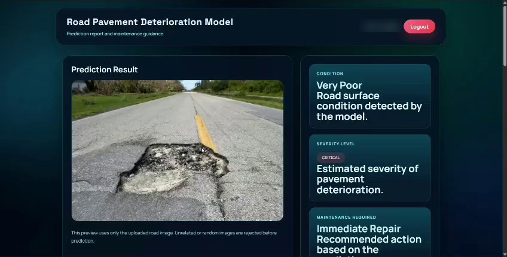

# 🛣️ Road Pavement Deterioration Model | Flask Web Application Prototype

[**🔗 Live Demo: road-pavement-project.vercel.app**](https://road-pavement-project.vercel.app/) &nbsp;|&nbsp; [**Login Page**](https://road-pavement-project.vercel.app/login)

[](prediction-result.jpg)

---

# 📌 Project Overview

This project is a **Flask web application prototype** for reviewing pavement-condition data and presenting road-inspection results with maintenance guidance. It combines a sign-in flow, a road-image submission dashboard, a prediction report, and a history page, backed by a pavement dataset of more than one million records.

The objective is to provide a simple workflow for signing in, submitting a road-surface image, viewing a pavement-condition and maintenance summary, and reviewing recent results.

---

# 🎯 Project Objectives

This project aims to demonstrate how to:

- Sign in securely with a local account or Google (when OAuth is configured)
- Submit a road-surface image by upload or camera capture
- View a pavement condition, severity level, and maintenance recommendation
- Review recent result summaries from a history page
- Explore a large pavement dataset with descriptive statistics

---

# ✨ Key Features

- **Authentication:** username or email sign-in, local account creation, password-reset link, and optional Google sign-in
- **Image submission:** upload from a device or capture with the camera
- **Prediction report:** condition, severity level, and recommended maintenance action shown next to the submitted image
- **History:** up to 20 recent result summaries kept per session
- **Dashboard insights:** condition-drift and distress-intensity cards in a dark monitoring-style interface

---

# 🛠️ Tools & Technologies

| Tool | Purpose |
|------|---------|
| Python | Core application language |
| Flask | Application and routes |
| HTML, CSS, Jinja | User interface and templates |
| Pandas, NumPy | Dataset loading and analysis |
| SQLite, Flask sessions | User and session data |
| OpenCV, Pillow, scikit-learn, joblib | Image and model-related dependencies (listed in `requirements.txt`, not yet used for inference) |
| [Vercel](https://road-pavement-project.vercel.app/) | Deployment |

---

# 📂 Dataset Information

The application loads `ESC 12 Pavement Dataset.csv` from the `road_pavement_project` directory. The file contains **1,050,000 records** and **10 fields**, with no missing cells in the inspected export.

### Important Columns

| Field | Description |
|-------|-------------|
| `Segment ID` | Identifier for a road segment |
| `PCI` | Pavement Condition Index (0–100) |
| `Road Type` | Road classification (Primary, Secondary, or Tertiary) |
| `AADT` | Annual Average Daily Traffic |
| `Asphalt Type` | Recorded surface type (Asphalt or Concrete) |
| `Last Maintenance` | Recorded year of the last maintenance |
| `Average Rainfall` | Average rainfall value; the dataset does not specify its unit |
| `Rutting` | Rutting measurement (the application labels repair values in millimetres) |
| `IRI` | International Roughness Index value |
| `Needs Maintenance` | Maintenance indicator (`1` = yes, `0` = no) |

---

# 🚀 Project Workflow

```
User Registers / Signs In
        │
        ▼
Dashboard: Upload or Capture Road Image
        │
        ▼
Flask Route Saves Image to static/uploads
        │
        ▼
Row Sampled from Pavement Dataset (CSV)
        │
        ▼
Condition, Severity & Maintenance Summary Generated
        │
        ▼
Prediction Page + History (up to 20 entries)
```

---

# 📈 Dataset Insights

- The mean PCI is **54.71**.
- Applying the application's PCI bands, about **36.96%** of records are Very Poor, **13.02%** Poor, **12.95%** Fair, **18.14%** Good, and **18.93%** Excellent.
- **524,869 records (49.99%)** are marked as needing maintenance.
- Tertiary roads are the largest road-type group, with **489,465 records (46.62%)**.
- Average recorded rutting is **16.59**, and average IRI is **0.85**.

> ⚠️ **Data quality warning:** the inspected export includes negative AADT and IRI values, and maintenance years as late as 2028. Validate and clean the data before using it for operational decisions.

These are descriptive statistics for the supplied CSV, not evidence of model accuracy or causal relationships.

---

# 📸 Application Preview

## 🔐 Login Page

<p align="center">
  
</p>

## 📊 Dashboard & Image Upload

<p align="center">
  
</p>

## 🧾 Prediction Result

<p align="center">
  
</p>

*Screens were captured from the deployment walkthrough. See [Prototype Notes](#-prototype-notes--limitations) for differences in the checked-in backend.*

---

## 🎥 Project Demonstration

<p align="center">
  <a href="project-demo.mp4">
    
  </a>
</p>

<p align="center">
  <a href="project-demo.mp4">▶️ <strong>Watch the full demo video</strong></a>
</p>

> 💡 **Tip:** GitHub plays a video inline when it is uploaded through the GitHub web editor. To embed the full video player, edit this README on GitHub, drag `project-demo.mp4` into the editor, and keep the generated link on its own line here.

---

# 🌐 Deployment

The application is deployed on **Vercel** and is publicly accessible:

| Item | Details |
|------|---------|
| **Live URL** | [https://road-pavement-project.vercel.app/](https://road-pavement-project.vercel.app/) |
| **Login page** | [https://road-pavement-project.vercel.app/login](https://road-pavement-project.vercel.app/login) |
| **Platform** | Vercel |
| **Framework** | Python / Flask |
| **Application directory** | `road_pavement_project` |
| **Dependencies** | Installed from `road_pavement_project/requirements.txt` |

### Deployment Steps

1. Push the repository to GitHub.
2. Sign in to [Vercel](https://vercel.com) and choose **Add New → Project**.
3. Import the GitHub repository.
4. Set the **Root Directory** to `road_pavement_project` (the folder that contains `app.py` and `requirements.txt`).
5. Add any required environment variables (for example, a Flask secret key, and Google OAuth credentials if Google sign-in is enabled).
6. Click **Deploy**. Vercel builds the app and publishes it at a `*.vercel.app` URL.
7. Every later push to the connected branch triggers an automatic redeployment.

### Deployment Notes

- Vercel runs Flask as a **serverless function**, so the filesystem is read-only except for temporary storage. Uploaded images saved to `static/uploads` and the SQLite user database are **not persistent** on Vercel; they can be lost between requests or redeployments. Use external storage and a hosted database for production use.
- Google sign-in works only when OAuth credentials are configured for the deployed domain.
- Result history is kept in the Flask session (up to 20 entries), not in a database.
- The dataset (`ESC 12 Pavement Dataset.csv`, 1,050,000 records) must be included in the deployment bundle for the prediction route to use real rows; otherwise the app returns a demo result.

---

# 📁 Project Structure

```
Road-Pavement-Deterioration-Model/
│
├── road_pavement_project/
│   ├── app.py
│   ├── model.py
│   ├── requirements.txt
│   ├── ESC 12 Pavement Dataset.csv
│   ├── templates/
│   └── static/
│       └── uploads/
│
├── login.jpg
├── dashboard-upload.jpg
├── prediction-result.jpg
├── project-demo.mp4
├── demo-preview.gif
└── README.md
```

---

# 🎯 Skills Demonstrated

### Backend

- Flask routing and sessions
- User authentication flow
- SQLite user storage
- File upload handling

### Data

- Pandas and NumPy dataset analysis
- Threshold-based condition and severity banding
- Descriptive statistics on a 1M+ row dataset

### Frontend

- Jinja templating
- Responsive dark-themed UI
- Camera and file-upload interaction

---

# ⚠️ Prototype Notes & Limitations

- The current `/predict` route does **not** analyze the uploaded image. It selects a random dataset row; if the CSV is unavailable, it returns a demo result.
- Interface text in the deployed screens (for example, that unrelated images are rejected before prediction) describes intended behavior that the checked-in route does not implement.
- `model.py` contains a dummy model that generates random labels and is not called by the Flask prediction route.
- Severity and maintenance summaries use hand-written thresholds. Review and validate these thresholds and the source data before using results to plan real road maintenance.
- Results are for demonstration only and must not be treated as an engineering assessment.

---

# 🚀 Future Enhancements

- Real image-based damage detection (cracks, potholes, rutting) using a trained model
- Rejection of unrelated or low-quality images before prediction
- Data cleaning and validation pipeline for the pavement dataset
- Persistent history stored in a database instead of the session
- Maintenance prioritisation and cost estimation
- Map view of inspected road segments
## 👤 Author

**San097**
GitHub: [@San097](https://github.com/San097)
